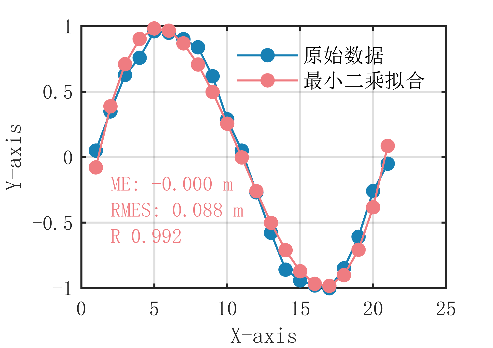

# MATLAB | Data Fitting Algorithm | Least Squares Fitting Algorithm Code | Included with data and plotting code | Directly Useable

1. Basic Definition The least squares fitting algorithm is a method of fitting based on the principle of least squares, which fits the given data points to obtain an optimal fitting curve to describe the data. The main idea of this algorithm is to minimize the residual sum of squares between data points and fitting curves, thereby obtaining the optimal fitting curve. Specifically, the steps of the least squares fitting algorithm are as follows:
Given a set of data points {(x1, y1), (x2, y2), ..., (xn, yn)}.
Assuming the fitted curve is y = f(x), where f(x) is an n-degree polynomial.
According to the principle of least squares, the sum of the squared differences between all data points and the fitted curve is minimized: ∑(yi-f(xi))^2
The objective is to solve for n+1 unknown coefficients, a0, a1, ..., an, such that the residual sum of squares is minimized. The merit of the least squares fitting algorithm lies in its ability to describe the overall trend of the data to some extent and it performs well on data with random errors. However, it may require other fitting methods for data with obvious nonlinear characteristics to achieve better fit results. Additionally, this algorithm can have a significant impact on the fitting results for data with extreme values.
2 Definition and drawing effect. The following is the drawing effect:
\n        \n  
Video tutorial operation:
\n        \n          \n          \n          \n          \n            To view this video please enable JavaScript, and consider upgrading to a\n            web browser that\n            supports HTML5 video\n  

## Images

<!-- PAYMENT_BLOCK -->

## Get this dataset

- Payment link (Stripe): [Buy now](https://buy.stripe.com/3cs8yP7sY87d0vu9AB)
- Payment QR code: 

<!-- /PAYMENT_BLOCK -->
